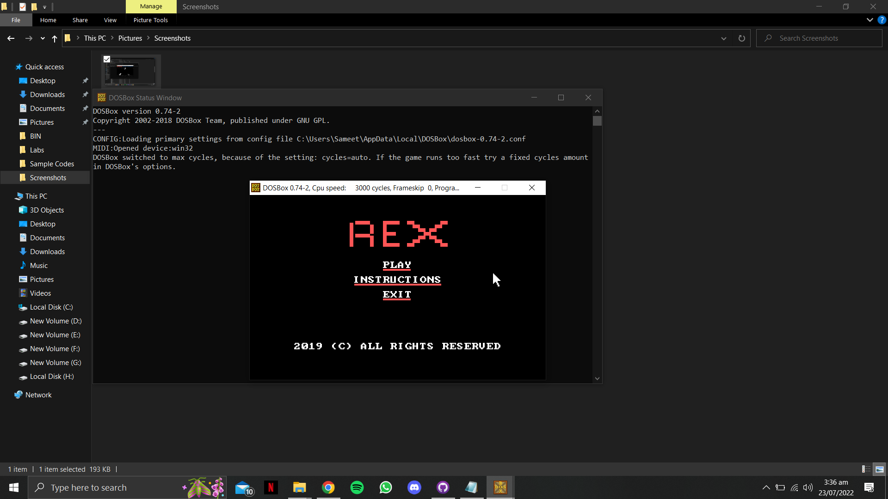
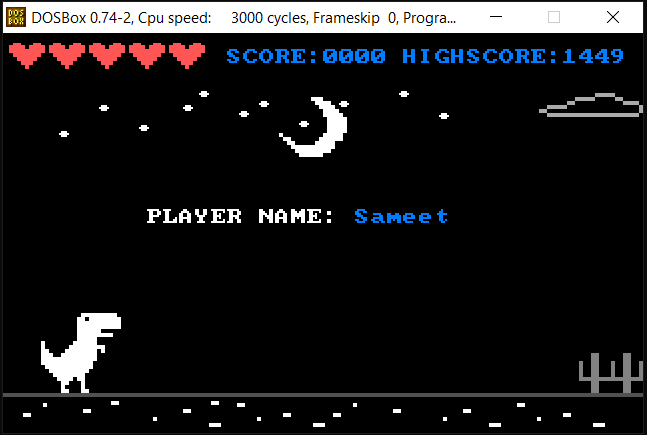
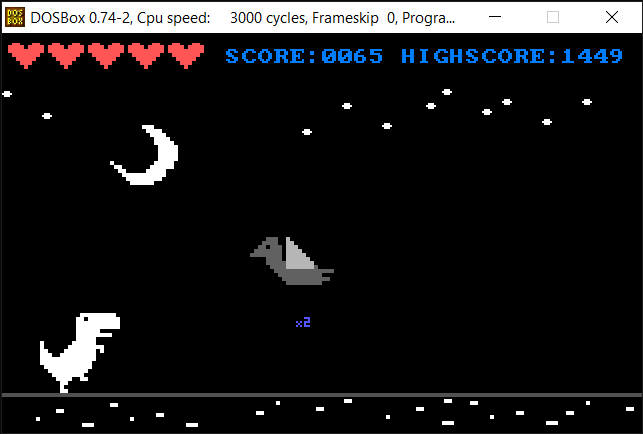
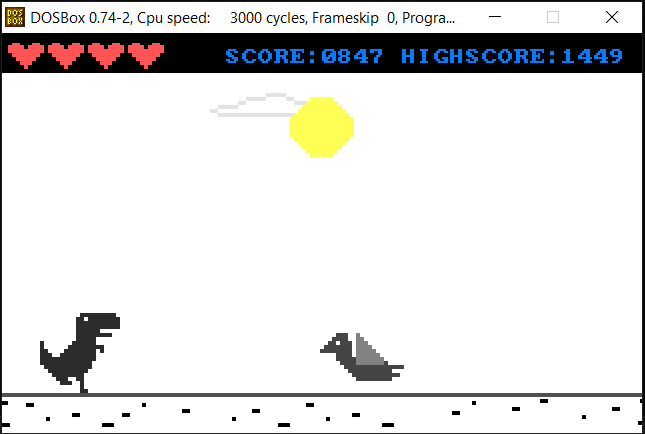

# T-Rex Dino Game in x86 Assembly

A graphical endless-runner game written in MASM-style x86 assembly for DOS. It extends the familiar browser dinosaur game with animated day/night scenes, several obstacle types, score multipliers, lives, persistent high scores, keyboard controls, and a mouse-driven menu.


## Highlights

- Original pixel graphics drawn directly from coordinate arrays.
- Jumping, crouching, and horizontal movement.
- Ground obstacles, flying obstacles, collision detection, and five lives.
- Hearts plus 2× and 5× score boosters.
- Day/night transitions, clouds, stars, sun, and changing colors.
- Menu, instructions, player-name input, timer, score, and high-score storage.
- BIOS and DOS interrupts for graphics, mouse, keyboard, sound, timing, and files.

See [Gameplay and implementation](docs/GAMEPLAY.md) for controls and a source-level overview.

## Build and run

The source targets the Microsoft Macro Assembler toolchain in a DOS-compatible environment.

1. Place the contents of `src` in a DOSBox-mounted working directory.
2. Assemble and link the program with MASM:

   ```dos
   ml main.asm
   ```

3. Run the generated executable:

   ```dos
   main.exe
   ```

Keep `file.txt` and `Score.txt` beside the executable because the game accesses them at runtime. Generated `.EXE` and `.OBJ` files are intentionally excluded from version control.

## Controls

| Input | Action |
| --- | --- |
| Space / Up Arrow | Jump |
| Down Arrow | Crouch |
| Left / Right Arrow | Move horizontally |
| Mouse | Select menu actions |

## Screenshots

| Main menu | Game start |
| --- | --- |
|  |  |

| Night gameplay | Day gameplay |
| --- | --- |
|  |  |

## Project status

This repository preserves the original academic assembly project and its source. Modern continuous integration validates repository structure and runtime assets; building the 16-bit DOS executable still requires MASM-compatible tooling.

## Authors

- Sameet Asadullah
- Maria Yasir
- Syed Hamza

## License

No license has been specified for this repository. The source remains copyrighted by its authors.
